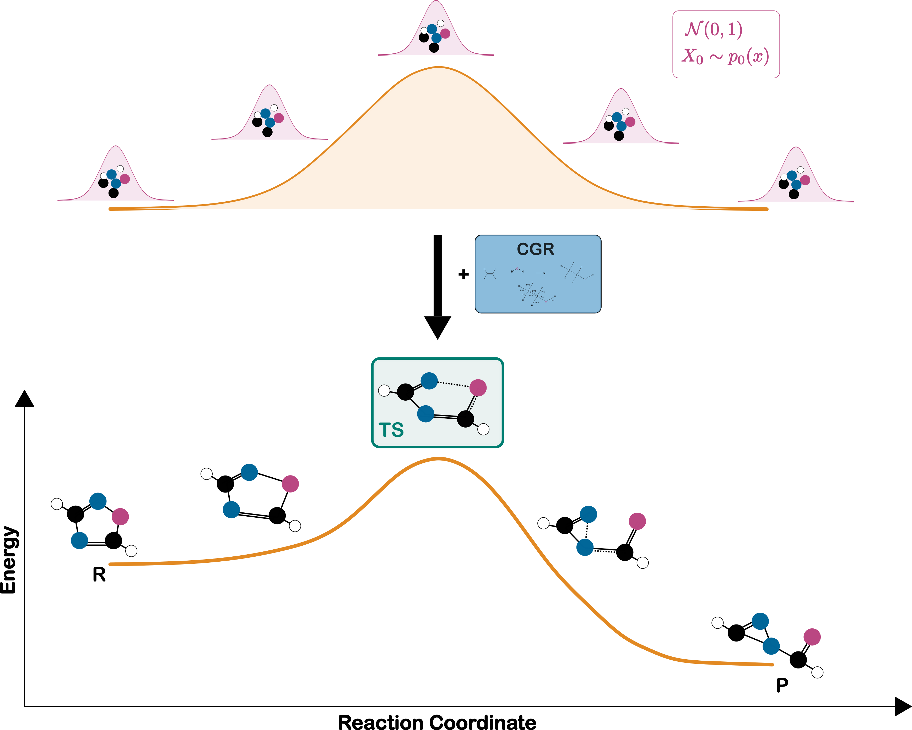

# GoFlow+NEB: Efficient Transition State Geometry Prediction with Flow Matching and E(3)-Equivariant Neural Networks utilizing Nudged Elastic Band

GoFlow is an open-source model for predicting transition state geometries of single-step organic reactions.
This repository contains the official implementation, including all scripts to fully reproduce the results reported in the paper.

My master thesis focused on expanding GoFlow with a concept from quatum mechanical calculations - Nudged Elastic Band - to enhance transition state prediction. 

## Idea


In this example, 5 NEB images are used to represent the reaction pathway from reactants to products. For each NEB image a random time t is sampled and atomic positions are drawn from Gaussian noise.


Visualization of spring force integration between 5 consecutive NEB images. Spring forces are computed based on inter-image distances along the reaction pathway, promoting geometric continuity. During training, these forces contribute to the overall loss, guiding the model to produce velocity fields that respect the physical connectivity of the NEB trajectory.

## Installation
Install GoFlow dependencies with uv (recommended):

```bash
# Install uv
pip install uv
# Install dependencies
uv sync -n
uv add torch_scatter torch_sparse torch_cluster torch_spline_conv torch_geometric -f https://data.pyg.org/whl/torch-2.6.0+cu124.html --no-build-isolation -n
```

## Configuration
We use [Hydra](https://hydra.cc/) for managing model configurations and experiments.

All hyper-parameters are found in the configs directory and its subdirectories (`./configs`).


## Dataset

GoFlow is trained and evaluated on the open-source [RDB7 database](https://zenodo.org/records/13328872) by [Spiekermann et al.](https://www.nature.com/articles/s41597-022-01529-6). The raw `.csv` and `.xyz` files are located in the `data/RDB7/raw_data` directory.

To set up the dataset when using the repository for the first time, follow these steps:

1. Generate indices required for creating the dataset splits by running the `preprocess_extract_rxn_core.sh` script.

3. Create split files by running the `preprocess_create_splits.sh` script, which produces `.pkl` files containing the split indices.

5. Preprocess the data by executing the `preprocessing.sh` script. This will generate the `data.pkl` file. Make sure to adjust the paths to the `.csv` and `.xyz` files inside the script as needed.

The processed data, i.e., each reaction, is stored as a [PyG](https://pytorch-geometric.readthedocs.io/) object in a Python list and is located in the `data/RDB7/processed_data` directory as `data.pkl`.


## Usage
Each experiment has a separate shell script (.sh files).

E.g. to train and test the model for all dataset splits, run `bash train_test_all_splits.sh` in a Unix shell.

To train and test with the NEB integration run `train_neb.sh` for model training. If using spring forces, it is possible to choose between linear or cosine annealing (spring forces increase over the training time).

Modify the shell scripts as required to set custom paths for your input and output directories. Also, edit the configuration files as needed.

To run quantum mechanical saddle point optimizations, use the `tsopt.inp` script for ORCA together with a predicted transition state geometry (xyz file).

## Acknowledgement

GoFlow is built upon open-source code provided by [TsDiff](https://github.com/seonghann/tsdiff) and [GotenNet](https://github.com/sarpaykent/GotenNet).

## License
Our model and code are released under MIT License.

## Cite

If you use this code in your research, please cite the following thesis:

@mastersthesis{gstoettenmayr2026neb,
  title   = {Integrating nudged elastic band with flow matching for enhanced transition state prediction},
  author  = {Gst{\"o}ttenmayr, Stephanie},
  year    = 2026,
  school  = {Technische Universit{\"a}t Wien},
  address = {Vienna, Austria},
  type    = {Diploma thesis},
  doi     = {10.34726/hss.2026.139520},
  url     = {https://doi.org/10.34726/hss.2026.139520}
}

Original GoFlow code:

```bibtex
@article{galustian2025goflow,
  author = {Galustian, Leonard and Mark, Konstantin and Karwounopoulos, Johannes and Kovar, Maximilian and Heid, Esther},
  title = {GoFlow: Efficient Transition State Geometry Prediction with Flow Matching and E(3)-Equivariant Neural Networks},
  year = {2025},
  doi = {10.26434/chemrxiv-2025-bk2rh},
  journal = {ChemRxiv}
}
```

